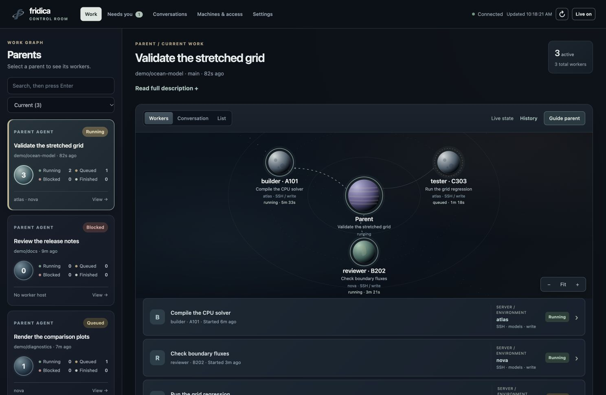

# Fridica

Fridica answers Slack threads as you and delegates work to Claude Code or Codex on your machines. One daemon represents one Slack account. Its local parent agent decides when to reply and what to delegate. Each thread keeps its own conversation, decisions and workers, so a follow-up can continue a job on the same machine.

## Install

On the daemon machine, use macOS or Linux with Python 3.11 or newer. In a Python virtual environment, install Fridica and create its configuration.

```sh
python -m pip install fridica
fridica init
```

For an isolated command-line installation, use `pipx install fridica` in place of the pip command. The wheel includes the native CLI and its credential helper. To install the version in this checkout, run `python -m pip install .` from the repository root with Rust 1.91 or newer.

`fridica init` creates four files under `~/.config/fridica/`:

| File | What to do with it |
| --- | --- |
| `config.toml` | Set the Slack identity, channels, backends and workspaces. |
| `manifest.yaml` | Import it when creating your Slack app. |
| `contract.md` | Customize how Fridica participates, replies and delegates. |
| `secrets.yml` | Use this optional mapping if your deployment uses Summon. |

For an existing installation with legacy state, stop the daemon, back up its configuration and database, and preview the migration with `fridica migrate --dry-run` before running `fridica migrate`.

### Prepare the machines

- **Daemon:** Install and sign in to the parent backend on this machine. The default is Claude Code. To use Codex, set `backend = "codex"` under `[parent]`.
- **Workers:** Install and sign in to every backend listed for that machine. Fridica's helpers use `/usr/bin/python3`. On SSH machines, the account must be reachable without a prompt, and the backend commands must be on its noninteractive `PATH`. Install Fridica there too when using the bundled GitHub, alphaXiv, ADS or Overleaf tools.

Backend installation guides: [Claude Code](https://code.claude.com/docs/en/setup) and [Codex CLI](https://developers.openai.com/codex/cli).

### Linux worker sandbox

Install `bubblewrap` on every Linux worker host, including Codex-only hosts. Install `socat` as well if the host runs Claude. Use `sudo apt install bubblewrap socat` on Debian or Ubuntu, or `sudo dnf install bubblewrap socat` on Fedora.

Run Fridica’s sandbox check on the worker host as the worker user. Success produces no output and exits with status 0.

```sh
bwrap --unshare-user --unshare-net --ro-bind / / --dev /dev --proc /proc --die-with-parent -- /bin/true
```

<details>
<summary>Ubuntu 24.04 and later: AppArmor blocks user namespaces</summary>

If the check fails with a UID map or loopback permission error, run these on the affected host:

```sh
command -v bwrap
sysctl kernel.apparmor_restrict_unprivileged_userns
```

If the path is `/usr/bin/bwrap` and the setting is `1`, check the AppArmor profile for that executable. If the profile is missing, create `/etc/apparmor.d/bwrap` with the following contents. Preserve any existing site-specific rules.

```text
abi <abi/4.0>,
include <tunables/global>

profile bwrap /usr/bin/bwrap flags=(unconfined) {
  userns,
  include if exists <local/bwrap>
}
```

Run `sudo systemctl reload apparmor` and repeat the sandbox check as the worker user. [AppArmor setup for bubblewrap](https://code.claude.com/docs/en/sandboxing#add-an-apparmor-profile-for-bubblewrap)

</details>

## Configure Slack

1. In [Slack app management](https://api.slack.com/apps), choose **Create New App → From an app manifest**, select your workspace and import the generated `manifest.yaml`. Use one app per owner. The manifest enables Socket Mode and subscribes to messages in public channels.
2. Under **Basic Information → App-Level Tokens**, generate an `xapp-` token with `connections:write`. For private channels, also add the `groups:read` and `groups:history` **user token scopes** and the `message.groups` **user event** before installing the app.
3. Under **OAuth & Permissions**, install the app to your workspace as the person Fridica will represent. Copy the `xoxp-` **User OAuth Token**. That account must belong to each channel you configure.
4. As the OS user who will run the daemon, run `fridica doctor` to see which tokens are available and whether Slack accepts them. You can run it before `fridica init`. The starter configuration automatically uses existing environment or keyring tokens. Store only missing tokens, then select your channels:

   ```sh
   fridica secret set slack/app-token
   fridica secret set slack/user-token
   fridica configure --detect
   ```

Detection reads your Slack identity and joined channels. For unattended setup, repeat `--channel-name NAME` with `--detect`. By default, **any member of a configured channel can request work on your machines**. Set `[slack].delegate_channels` to the channel IDs where you want to allow delegation. Fridica supports public and private channels. [Shipped Slack manifest](assets/slack-manifest.yaml)

If your installed CLI lacks the `secret` command, set `SLACK_APP_TOKEN` and `SLACK_USER_TOKEN` in your environment before running `fridica configure --detect`.

The generated configuration uses macOS Keychain or Linux Secret Service. On Linux, the daemon needs a user D-Bus session with an unlocked keyring. When using environment variables, supply them to the daemon process as well. They take precedence over stored entries. To rotate a stored token, repeat its `secret set` command and restart the daemon.

`fridica secret set slack/app-token` stores the token as a generic password in macOS Keychain or as a secret in the default Linux Secret Service collection (such as GNOME Keyring). Both use the current OS username as the account, `fridica:fridica/slack/app-token` as the service, and the token as the password. The entry has no website. Running `secret set` on an older Fridica entry moves it to this format.

`fridica secret get slack/app-token` writes the token to stdout. Both this command and the `fridica-secret` provider check the corresponding environment variable first (`SLACK_APP_TOKEN`, `SLACK_USER_TOKEN`, or `FRIDICA_GITHUB_TOKEN` for `github/read-prs`). For a custom token, use `fridica secret get example/api-token --env EXAMPLE_API_TOKEN`. If the variable is unset, Fridica reads the stored password.

## Configure machines

Edit the existing tables in `config.toml`. Choose only the backends installed on each machine and point each workspace at an **existing directory**. The starter lists both Claude and Codex and uses `~/project` as a placeholder. For example, a local Codex installation with one checkout can use:

```toml
[parent]
backend = "codex"

[machines.local]
transport = "local"
backends = ["codex"]

[machines.local.workspaces]
project = { path = "~/repos/my-project", subfolders = false }
```

To add an SSH machine, give it a host alias and at least one workspace. Tags let the parent place a request such as “run this on a CUDA machine.”

```toml
[machines.gpu]
transport = "ssh"
host = "gpu-box"
backends = ["codex"]
tags = ["cuda"]
resources = { gpus = [0] }
max_jobs = 1

[machines.gpu.workspaces]
experiments = "/data/experiments"
```

The generated template documents machine limits, load-aware placement, GPU confinement and policy overrides. Use local or SSH transport for jobs. Slurm entries can be configured, but job execution is unimplemented. [Configuration template](src/config/template.toml)

### Workspaces and permissions

- Writable workspaces normally give each slot its own `worker1/`, `worker2/`, and so on. Set `subfolders = false` for a shared checkout. Jobs there can touch the same files. In managed slot directories, Fridica cleans old scratch files before reuse. Place `.fridica-keep` in a directory to preserve its subtree.
- Set `[policy].mode` to `read-only`, `write` or `full` and override it per machine or workspace as needed. For Codex's ordinary sandbox, a nonempty `network` list enables general network access. GPU confinement uses the host network and bounds filesystem writes. Declared GPUs are assigned by job slot.
- `approvals = "auto"` uses the backend reviewer. Choose `on-request` for owner decisions on escalation, `untrusted` for more frequent prompts, or `never` to deny escalation. Pending requests appear in the dashboard and in `fridica approvals`.
- For scoped access to a public GitHub ref, configure `fetch_repos`, `network = []` and `approvals = "on-request"` on a writable workspace without GPU confinement. The worker receives a bare repository and the fetched commit SHA.
- To use an existing Python virtual environment for worker commands and MCP servers, set `python_env = "~/pyenv"` in the machine table. Fridica activates it on the execution machine.

## Run

```sh
fridica doctor
fridica start
```

`doctor` checks configuration, credentials, backend sign-in, workspaces and sandbox prerequisites. `start` runs in the foreground, verifies Slack access and begins answering threads. Use Ctrl-C to stop it.

| To do this | Run |
| --- | --- |
| Check startup prerequisites without connecting to Slack | `fridica start --check-ready` |
| Record Slack intake without calling models, starting workers or posting replies | `fridica start --observe-only` |
| Print a Linux systemd user unit for the configured daemon | `fridica service-print` |

## In Slack

Mention the owner in a configured channel and ask for work in a named workspace. For the example workspace above, ask “Run the tests in the project workspace and summarize the failures.” Reply in the same thread to refine the request. The parent can reuse a worker, delegate to several machines, or ask for clarification. Set `[slack].general_messages = false` to turn off unsolicited participation in general conversation.

The parent reads thread history, selected text attachments and worker summaries. It can pass Slack files to a worker as read-only inputs. Workers report results, progress and requested artifacts back through the daemon. The Slack app needs `files:read` to download attachments and `files:write` to upload reports and figures.

Customize the owner's voice and delegation rules in `contract.md` beside the configuration. Keep the required `## Participation` and `## Replies` headings. Use `## Delegation` for parent instructions and `## Worker reports` for instructions given to workers. [Default contract](assets/contract.md)

## GitHub links

When a thread links a GitHub issue or pull request, the daemon reads up to three links per call through `gh api`. The parent receives the title, state and selected status lines. Pull requests also include the head commit, checks and reviews. Replies may repeat private repository information, so give the reader access only to repositories those channels may see.

The daemon can use its existing GitHub CLI credentials. A new configuration automatically selects an existing `github/read-prs` keyring entry. To add a dedicated read-only credential after initialization, run `fridica secret set github/read-prs` and enable the token line in the existing table:

```toml
[github]
enabled = true
token = "keyring://github/read-prs"
cache_seconds = 60
```

Fridica supplies the resolved secret to its `gh` process as `GH_TOKEN`. No interactive login is required. If present, the legacy `FRIDICA_GITHUB_TOKEN` variable overrides the keyring entry. Set `enabled = false` to disable these lookups.

## Worker integrations

**GitHub.** The bundled GitHub MCP server is enabled by default for eligible local and SSH workspaces with GitHub network access. Read-only workspaces expose read tools. Writable workspaces can also publish reviews, comments and task-branch changes. Enabling these tools authorizes their use without a second Fridica approval. GitHub enforces the worker credential's repository permissions and branch protections. Scoped-fetch placements receive no GitHub MCP server.

Authenticate as the worker's execution user with `gh auth login --hostname github.com`, or provide a worker `GH_TOKEN`. The daemon's dedicated GitHub reader secret stays with the daemon. Set `[github.mcp].enabled = false` to disable worker GitHub tools.

**alphaXiv.** Set `[alphaxiv].enabled = true`, allow `api.alphaxiv.org` in the workspace network policy, and provide `ALPHAXIV_TOKEN` to the daemon. On an authenticated worker, `fridica alphaxiv-mcp --probe` checks tool discovery without running a search.

**NASA ADS (SciX).** Set `[scix].enabled = true`, allow `api.adsabs.harvard.edu` in the workspace network policy, and provide `ADS_TOKEN`. Workers can search papers, export citations and manage ADS libraries. Because the bundled server includes library edits, Fridica attaches it to writable placements. Run `fridica scix-mcp --probe` on the worker to verify ADS accepts the token.

**Overleaf.** Set `[overleaf].enabled = true` and provide `OVERLEAF_GIT_TOKEN`. Use a dedicated workspace with `mode = "full"` and `network = ["*"]` because the server accepts arbitrary Git remotes and local paths. Install Git on the worker, plus TeX Live for compilation and PDF review. Name the project by link or ID, or set `OVERLEAF_PROJECT_ID` for a default. Citation checks use `ADS_TOKEN`. Run `fridica overleaf-mcp --probe` to check the token setting and discover tools locally. A project pull verifies remote access.

Running `fridica doctor` checks each enabled research server on its eligible local and SSH workspaces. Its ADS check verifies authentication with a zero-result query. Its Overleaf check verifies that the token is set and lists the bundled tools locally. Project access requires a separate pull.

**Worker credentials.** Local workers inherit a filtered daemon environment. SSH workers receive integration credentials over encrypted SSH stdin, including variables such as `GH_TOKEN`, `ALPHAXIV_TOKEN` and `AWS_SECRET_ACCESS_KEY`, plus explicitly named MCP credentials. Forwarded values take precedence over target-local values. Fridica filters configured daemon secrets and Slack credentials before launching agents. [Credential forwarding rules](src/exec/credentials.rs)

## Dashboard and CLI

With the daemon running, open a second terminal and run `fridica dashboard`. Open the printed loopback URL on the same machine. The dashboard shows thread conversations, worker relationships and job history. You can send instructions, decide approvals and retry failed posts there.



| Task | Command |
| --- | --- |
| Check current activity | `fridica status`, `fridica threads`, `fridica workers`, `fridica machines` |
| Follow the event feed | `fridica events --follow` |
| List outstanding mentions | `fridica obligations` |
| Send a thread an instruction | `fridica instruct THREAD_ID "Run the tests again"` |
| Decide a pending approval | `fridica approvals ID once` (also `session` or `deny`) |
| Retry a failed parent decision | `fridica threads THREAD_ID retry` |
| Inspect failed or ambiguous posts | `fridica outbox` |
| Search archived threads | `fridica archive search "test failures"` |

The CLI and dashboard reach the daemon over its owner-only Unix socket. Use `fridica --help` for all commands. Local integrations can follow the event feed or drive a thread through the control API. [Events](docs/events.md) · [External drivers](docs/external-driver.md)

## State and recovery

Fridica stores messages, thread state, jobs and outgoing posts in SQLite. It records incoming Slack events before acknowledging them and commits each thread turn's effects together. After a restart, catch-up recovers missed messages and interrupted jobs are reported to their threads. Set `[limits].auto_resume = true` to rerun interrupted jobs once.

If delivery to Slack is uncertain, the post becomes `ambiguous`. Check the Slack thread before using `fridica outbox ID` to retry. Finished, quiet threads move to weekly archives beside the database after `state.archive_after_days` (default 7). A new message in an archived thread restores its history.

## Development

The daemon is written in Rust. Its Python distribution packages the executables with Maturin. From a source checkout, run:

```sh
cargo test --locked --all-targets
cargo test --locked --doc
python -m pip install -r requirements-dev.txt
python -m pytest -q
node --test tests/dashboard*.cjs
```

Build a wheel with `maturin build --release --locked --out dist`. The wheel smoke test exercises the installed command-line tools. [Wheel smoke test](scripts/smoke_wheel.sh) · [CI workflow](.github/workflows/ci.yml)

## License

[MIT](LICENSE)
